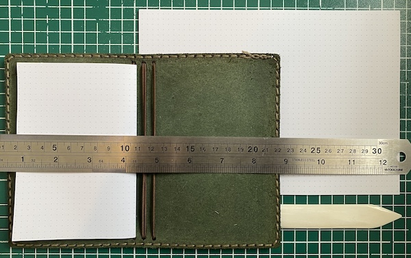

[Craig Mod made a notebook](https://craigmod.com/ridgeline/237/). It started life as a paper and binding tests for the Japanese edition of Kissa by Kissa, and then got refined into his vision of what a perfect pocket notebook ought to be. This impressed me in two ways:

1. You should have strong opinions about the perfect pocket notebook.
2. Human agency is a wonderful thing and if you have strong opinions about the perfect notebook, you can just make it.

Craig sells his perfect notebook, but he doesn't sell MY perfect notebook. Refer to point 2.

I'm starting from the current position:

- My handwriting is pretty small. 4-5mm lines is plenty.
- I mostly use a fountain pen, sometimes a ballpoint. Paper must accomodate this by not bleeding or feathering or ghosting.
- I am a fan of dot grid paper. I would be happy if all of my non-drawing notebooks were dot grid.
- I like to put notebooks in separate covers, so a thin and flexible cover beats a hardback. Alternatively the cover can hold loose sheets to be bound into a volume later. This gives me an excuse to do crafts.
- I don't have strong feelings about corner roundness, but I'm inclined to think anything over 7mm is extravagance.
- Depending on purpose, a notebook should be no smaller than a Field Notes and no larger than A5.
- 100gsm is a sweet spot. Less than 80gm is like, come on.
- Ribbons are a nice touch, but not essential.
- I don't want a pen loop.

This is the first iteration. Specs:

- Pocket notebook cover from [Galen Leather](https://www.galenleather.com).
- 4x eight page sections of 104gsm paper from [dotgrid.co](https://www.dotgrid.co). The paper comes in short grain A5 to make B6 notebooks, but I trimmed it to 90mm x 135mm to fit the pocket size cover.

The plan is to finish writing in it and then bind the four sections into a single volume to live their lives in peace on a shelf somewhere.

<small>I don't get anything for posting the product links.</small>
